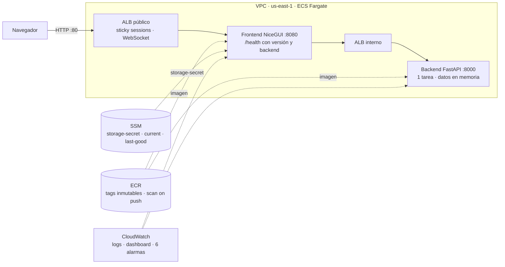
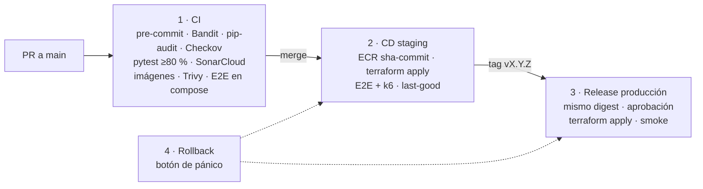

# Gastico 💸

Control de gastos personales. Backend y frontend separados, ambos en Python, desplegados en
AWS (ECS Fargate) con un pipeline de CI/CD en GitHub Actions: trunk-based, tags SemVer y
rollback en 3 niveles. Proyecto final de Integración y Entrega Continua (EAFIT).

| Ambiente | URL | Se despliega con |
|---|---|---|
| staging | http://gastico-staging-alb-871422411.us-east-1.elb.amazonaws.com | cada merge a `main` |
| production | http://gastico-production-alb-304698265.us-east-1.elb.amazonaws.com | un tag `vX.Y.Z`, con aprobación |

Las URL viven mientras dure la sesión del AWS Learner Lab. `/health` dice qué versión está arriba.
Las evidencias de cada paso y de las demos están en [docs/evidencias/](docs/evidencias/README.md).

## Arquitectura (por ambiente)



- Solo el frontend da la cara a internet. El security group del backend solo acepta el ALB
  interno: desde internet no se llega a la API ni a `/docs`.
- El plan pedía Service Connect, pero el Learner Lab bloquea `servicediscovery`; por eso el ALB
  interno. Detalle y demás decisiones de Terraform: [infra/README.md](infra/README.md).
- Staging y producción son dos workspaces del mismo Terraform, con su estado en S3.
- Del SSM, el frontend solo lee el `storage-secret` de NiceGUI. `current` y `last-good` los usa
  el pipeline: el deploy, el release y el rollback.

## Pipeline



| Evento | Qué corre | Ambiente |
|---|---|---|
| PR a `main` | CI completo. El check `ci` es obligatorio en el ruleset `proteger-main` (squash y 1 aprobación) | ninguno |
| Merge a `main` | CI, publicación en ECR (`sha-<commit>`), deploy, E2E y carga con k6. Si todo pasa, la versión queda como `last-good` | staging |
| Tag `vX.Y.Z` | Verifica que el commit sea el `last-good` de staging, le pone el tag al **mismo digest** en ECR, pide aprobación, despliega y corre el smoke | production |
| Botón de pánico | `rollback.yml` a mano: vuelve al `last-good` (u otra versión) y repite el smoke | el que se elija |

Ramas, commits y versiones: [CONTRIBUTING.md](CONTRIBUTING.md). Para sacar un release, el tag
va sobre el commit que es el `last-good` de staging; si no, el job `verificar` lo rechaza:

```bash
git tag v1.2.0 <commit last-good de staging> && git push origin v1.2.0
```

También se puede crear desde GitHub: Releases → Draft a new release, con el tag sobre ese commit.

## Rollback en 3 niveles

| Nivel | Cuándo | Qué hace |
|---|---|---|
| 1 · ECS (automático) | La tarea nueva no pasa el health check | El circuit breaker vuelve a la versión anterior y el pipeline queda en rojo |
| 2 · Pipeline (automático) | El deploy quedó estable pero fallan el smoke, las E2E o k6 | Vuelve al `last-good` de SSM con el mismo Terraform y repite el smoke |
| 3 · Botón de pánico (manual) | Alguien del equipo ve un problema | Actions → "4 · Rollback": se elige ambiente y versión (vacío = `last-good`). Producción pide aprobación |

Los tres son un deploy más con el mismo Terraform y una imagen inmutable que ya pasó las
pruebas; nada se cambia a mano en la consola.

## Lo que agregamos sobre el Taller 3

1. **DevSecOps shift-left:** Bandit, pip-audit, gitleaks, Checkov, Trivy y escaneo de ECR como gates.
2. **Backend privado:** dos servicios de ECS y el backend sin acceso desde internet.
3. **Release por tags y rollback:** el mismo digest pasa de staging a producción, con `current`
   y `last-good` en SSM.
4. **Observabilidad:** monitoreo con CloudWatch (un dashboard y 6 alarmas por ambiente) y
   reportes Allure de las E2E publicados en GitHub Pages.

## Estrategia de pruebas

| Tipo | Herramienta | Dónde | Qué valida |
|---|---|---|---|
| Estáticas | ruff, SonarCloud | CI | Estilo, bugs comunes, Quality Gate |
| Seguridad | Bandit, pip-audit, gitleaks, Checkov, Trivy | CI | Código inseguro, CVEs, secretos, IaC, imagen |
| Unitarias y de componente | pytest (cobertura ≥ 80 %) | CI | Montos, categorías, resumen, contrato HTTP |
| Integración | Playwright + docker compose | CI | Front y back juntos en contenedores |
| Aceptación | Playwright | staging | Lo mismo, con la red de AWS, sticky sessions y WebSocket |
| Carga | k6 | staging | p95 de `/health` < 500 ms, página < 1,5 s, errores < 1 % |
| Smoke | pytest | staging y producción | Versión correcta y app viva, sin escribir datos |
| Manual | [checklist de QA](docs/qa/checklist-qa.md) | staging y producción | [Escenarios BDD](docs/qa/escenarios-bdd.md) que no se automatizan |

El reporte Allure de las E2E sale en el resumen de cada run del CI y del CD (link **Allure
report**), publicado en GitHub Pages. Ejemplo:
https://jalopezg4.github.io/Proyecto-CICD/e2e/reporte-e2e-ci/44228872687-1/

## Monitoreo

Cada ambiente tiene un dashboard de CloudWatch (`gastico-<env>`) con peticiones, errores,
latencia, tareas sanas y CPU/memoria, y 6 alarmas: 5xx, latencia p95, frontend o backend sin
tareas sanas y CPU alta. El estado de las alarmas sale en el resumen de cada run, así que se ve
sin credenciales de AWS. La prueba de las alarmas en staging está en
[docs/evidencias/](docs/evidencias/README.md#monitoreo).

## Limitaciones conocidas

- **Sin base de datos** (decisión del curso): los gastos viven en memoria en 1 tarea de backend.
  Se pierden al redesplegar, y por eso el backend no escala a más de 1 tarea.
- **Solo HTTP:** el Learner Lab no da dominio ni certificado, y el navegador dice "No es seguro".
- **Credenciales temporales:** los secrets de AWS del repo vencen con cada sesión del Learner Lab
  y hay que renovarlos antes de desplegar.
- **Alarmas sin notificación:** no hay SNS ni correo; se ven en la consola y en los runs.

## Desarrollo local

| Pieza | Tecnología | Puerto |
|---|---|---|
| `backend/` | FastAPI (API REST) | 8000 |
| `frontend/` | NiceGUI (UI en Python) | 8080 |
| `e2e/` | Playwright + TypeScript (Locators → Pages → Steps BDD → Specs) | 8101 / 8181 (propios) |

### Endpoints

| Método | Ruta | Qué hace |
|---|---|---|
| POST | `/gastos` | Agrega un gasto |
| GET | `/gastos?categoria=` | Lista gastos (filtro opcional) |
| DELETE | `/gastos/{id}` | Elimina un gasto |
| GET | `/gastos/resumen` | Total y totales por categoría |

Documentación interactiva: http://localhost:8000/docs

### Cómo correrla

Con Docker, igual que en el CI:

```bash
docker compose up -d --build
```

Sin Docker:

```bash
python -m venv .venv
.venv\Scripts\pip install -r backend/requirements.txt -r frontend/requirements.txt
```

Terminal 1 (backend):
```bash
cd backend
..\.venv\Scripts\python -m uvicorn app.main:app --port 8000
```

Terminal 2 (frontend):
```bash
cd frontend
..\.venv\Scripts\python main.py
```

Abrir http://localhost:8080

### Pruebas unitarias y cobertura

```bash
cd backend
..\.venv\Scripts\python -m pytest --cov --cov-report=term-missing --cov-report=html
```

```bash
cd frontend
..\.venv\Scripts\python -m pytest --cov --cov-report=term-missing --cov-report=html
```

El reporte HTML queda en `htmlcov/index.html` dentro de cada carpeta.
Análisis completo: [docs/punto2-pruebas-y-cobertura.md](docs/punto2-pruebas-y-cobertura.md)

### Pruebas de aceptación E2E (Playwright + TypeScript)

Requiere Node.js y el `.venv` de Python ya creado (las pruebas lo usan para levantar la app).

Instalación (una sola vez):
```bash
cd e2e
npm install
npx playwright install chromium
```

Las pruebas levantan solas el backend y el frontend en los puertos 8101/8181:
```bash
npm test
```

Otras opciones: `npm run test:headed` (ver el navegador), `npm run test:ui` (modo paso a paso)
y `npm run report` (reporte HTML con los pasos Dado/Cuando/Entonces).
Detalle: [docs/punto3-prueba-de-aceptacion-e2e.md](docs/punto3-prueba-de-aceptacion-e2e.md)

Contra una app que ya está arriba (docker compose o el ALB de staging), sin levantar nada:
```bash
E2E_BASE_URL=http://127.0.0.1:8080 npm test
```

Hay 10 escenarios: los 4 originales y los 6 marcados `automatizar` en
[docs/qa/escenarios-bdd.md](docs/qa/escenarios-bdd.md) (1.1, 2.1, 3.1, 3.3, 3.4 y 7.1).
El 1.1 compara el total antes y después, así que corre al final y solo (proyecto `resumen`).
Si falla otro escenario, el 1.1 aparece como "skipped" en el reporte, no como fallido.

### Smoke (staging y producción, solo lectura)

Escenarios 8.1 y 8.2: `/health` responde "ok" con la versión desplegada y la página principal
carga. Solo hacen GET, así que se pueden correr en producción.

```bash
pip install pytest
SMOKE_BASE_URL=http://127.0.0.1:8080 SMOKE_VERSION=dev python -m pytest smoke -v
```

`SMOKE_VERSION` es la versión que se acaba de desplegar: `sha-xxxxxxx` en staging y `vX.Y.Z` en producción.

### Prueba de carga (k6, solo staging)

10 usuarios durante 1 minuto pidiendo la página principal y `/health`. Falla si el p95 de `/health` pasa de
500 ms, si el de la página principal pasa de 1500 ms (NiceGUI la arma completa en el servidor)
o si los errores pasan del 1 %. No escribe datos. Los umbrales se calibran con staging en el paso 9.

```bash
k6 run -e BASE_URL=http://127.0.0.1:8080 k6/carga.js
# sin instalar k6, con Docker (contra compose):
docker run --rm -v "$PWD/k6:/scripts:ro" grafana/k6:1.4.2 run -e BASE_URL=http://host.docker.internal:8080 /scripts/carga.js
```

### Pre-commit

Requisitos antes del primer commit:

- `pip install pre-commit`.
- `cd e2e && npm ci`: los hooks de eslint y prettier son `language: system`, corren con el Node
  local y necesitan `node_modules` ya instalado.
- Terraform instalado, solo cuando exista `infra/` (los hooks `terraform_fmt`/`terraform_validate`
  no hacen nada mientras esa carpeta no tenga archivos `.tf`).

Instalar los hooks (una sola vez):

```bash
pre-commit install
```

Desde ahí, cada `git commit` corre automáticamente ruff (Python) y eslint/prettier (`e2e/`),
además de gitleaks y validaciones básicas de formato, y cada mensaje de commit se valida contra
Conventional Commits (ver [CONTRIBUTING.md](CONTRIBUTING.md)). Para correrlo manualmente sobre todo el repo:

```bash
pre-commit run --all-files
```

### Cómo contribuir

Ramas, formato de commits, Pull Requests y versiones: [CONTRIBUTING.md](CONTRIBUTING.md).
