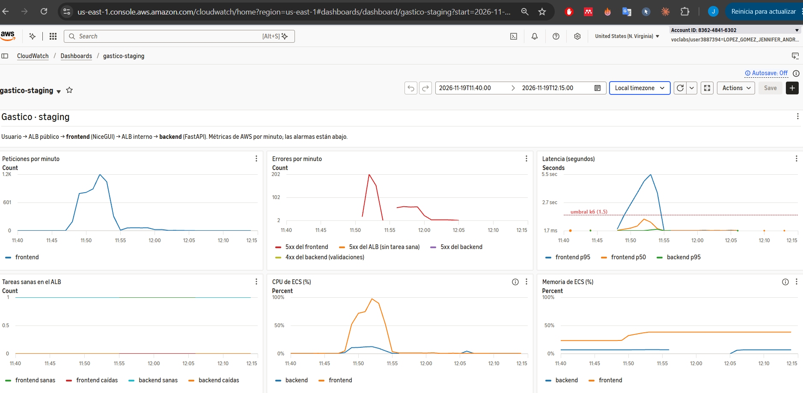
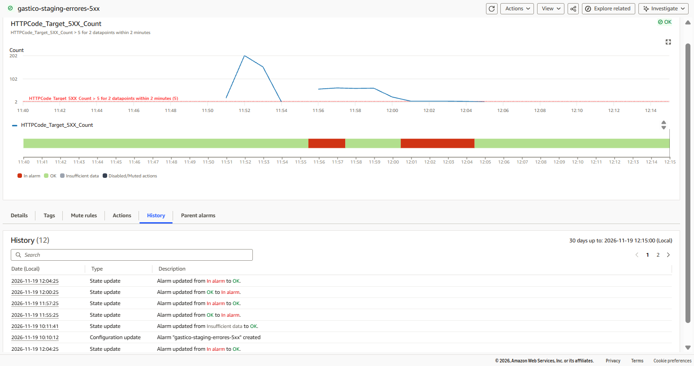
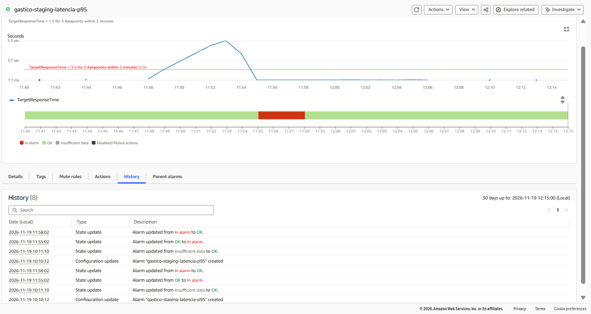
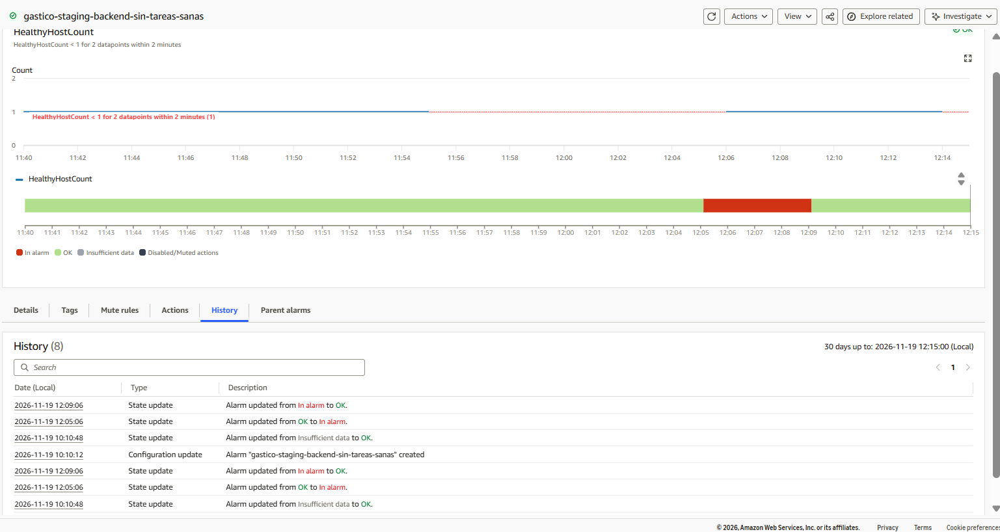

# Evidencias del monitoreo (CloudWatch)

Prueba del dashboard y las alarmas de staging (PR #18), el 19 de noviembre de 2026 entre las
11:40 y las 12:15 (hora de Colombia). Se hicieron dos cosas a propósito:

1. **Carga con k6 (11:48 a 11:54).** Unos 6 minutos de solo lectura: rampa hasta 15 usuarios,
   carga sostenida y un pico de 50. Es más fuerte que la prueba del CD (10 usuarios), para ver
   el límite.
2. **Caída del backend (11:55 a 12:06).** El servicio del backend se bajó a 0 tareas y después
   se volvió a dejar en 1.

Staging quedó normal al terminar. Producción no se tocó.

## Resultado

| Hora | Qué pasó | Alarma |
|---|---|---|
| 11:48 – 11:54 | k6: hasta ~1.200 peticiones por minuto, CPU del frontend en ~97 %, latencia p95 de ~5 s y hasta 202 errores 5xx por minuto (el 15 % de las páginas falló en el pico de 50 usuarios) | — |
| 11:55 | | 🔴 `errores-5xx` y 🔴 `latencia-p95` |
| 11:57 – 11:58 | Termina la carga | ✅ las dos vuelven a OK |
| 12:00 | Backend caído: `/health` del frontend responde 503 | 🔴 `errores-5xx` |
| 12:04 | | ✅ `errores-5xx` |
| 12:05 | El backend lleva varios minutos sin tareas sanas | 🔴 `backend-sin-tareas-sanas` |
| 12:06 | El backend vuelve a 1 tarea | |
| 12:09 | | ✅ `backend-sin-tareas-sanas` |

**Hallazgo:** con 1 tarea de 0,5 vCPU, el frontend aguanta bien unos 15 usuarios, pero con 50 se
satura (CPU al ~97 %). Se mejoraría con más CPU o más tareas de frontend; las sticky sessions que
necesita NiceGUI para eso ya están configuradas en el ALB.

## Pantallazos

### Dashboard de staging

Peticiones, errores, latencia (con la línea del umbral de k6 en 1,5 s), CPU y memoria. Se ven las
dos olas de 5xx: la del pico de k6 (11:52) y la del backend caído (desde las 11:56).

En "Tareas sanas en el ALB" no se ve la caída del backend. Con 0 tareas, AWS no publica un 0:
deja de publicar el dato, y la gráfica no dibuja ese tramo. Por eso la alarma está configurada
con "sin datos = alarma" (abajo).

### Alarma de errores 5xx

Dos veces en rojo: por la carga (11:55 – 11:57) y por el backend caído (12:00 – 12:04).

### Alarma de latencia p95

La p95 pasó de 1,5 s durante 3 minutos seguidos en el pico de k6 (11:55 – 11:58).

### Alarma de backend sin tareas sanas

La línea se corta cuando el backend se queda sin tareas y la alarma pasa a rojo (12:05 – 12:09).
Tarda unos minutos en saltar porque tiene que esperar a que falten 2 datos seguidos.

## Cómo repetirla

1. Carga: `k6 run -e BASE_URL=<url de staging> k6/carga.js`, con más usuarios en `stages` si se
   quiere ver la saturación. **Solo contra staging.**
2. Caída del backend (solo staging):
   `aws ecs update-service --cluster gastico-staging --service gastico-staging-backend --desired-count 0`,
   esperar ~5 minutos y volver con `--desired-count 1`.
3. CloudWatch → Dashboards → `gastico-staging`, rango "1h"; y Alarms → cada alarma → History.

El estado de las alarmas también sale en el resumen de cada run del CD, sin credenciales de AWS.
