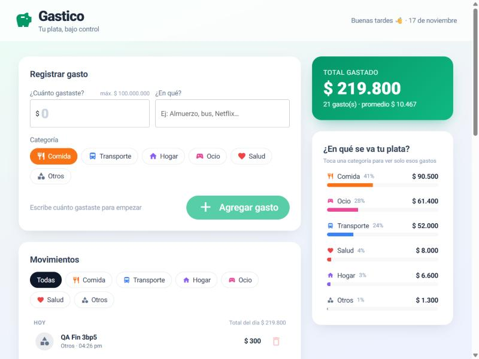
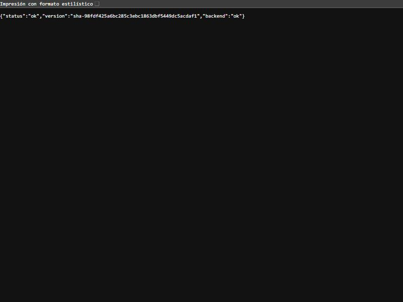

# Evidencias del paso 9: primer despliegue a staging

Primer despliegue hecho por el pipeline (merge del PR #10), con la versión `sha-98fdf42`.
Capturas y datos tomados el 17 de noviembre de 2026.

## Pipeline

| Workflow | Run | Duración |
|---|---|---|
| CI en `main` | [44119405375](https://github.com/jalopezg4/Proyecto-CICD/actions/runs/44119405375) | 3 min |
| CD staging | [44120037255](https://github.com/jalopezg4/Proyecto-CICD/actions/runs/44120037255) | 8 min (primera vez: crea toda la infraestructura) |

## App en staging

URL: http://gastico-staging-alb-871422411.us-east-1.elb.amazonaws.com

Los gastos que se ven ("QA Fin …") los crearon las pruebas E2E automáticas del CD.

## `/health`

Responde la versión desplegada y confirma que el frontend llega al backend, que es privado,
a través del ALB interno:

## Estado de AWS

[`evidencia-aws.md`](evidencia-aws.md) muestra:
- los servicios de ECS (1/1 tareas cada uno);
- los target groups `healthy`;
- el security group del backend, que solo acepta el ALB interno;
- `current` y `last-good` en SSM.

Desde el PR #11, este mismo resumen sale automáticamente en cada run de "CD staging".

**Escaneo de ECR:** en este despliegue aparece como "no disponible". Las imágenes se subieron
como *image index* (el formato por defecto de Docker 29), que ECR no puede escanear. El PR #11
lo corrige y, desde el siguiente despliegue, el resumen muestra los hallazgos.
