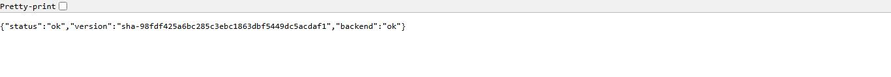
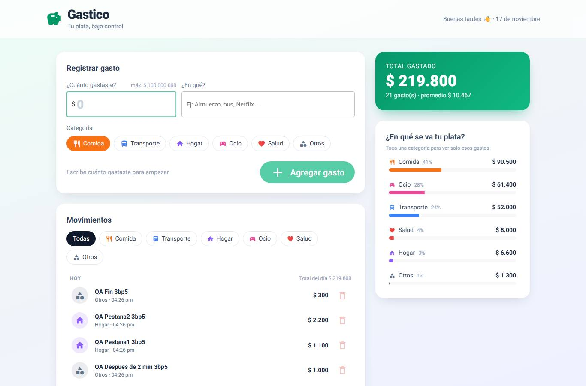
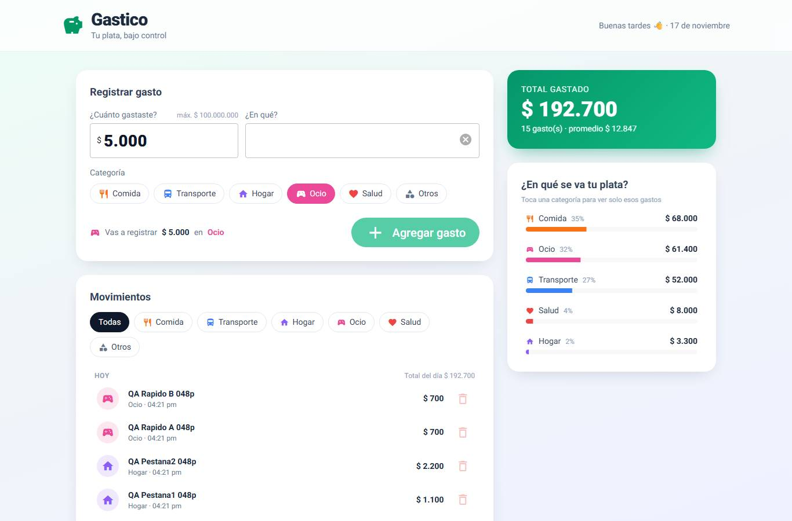
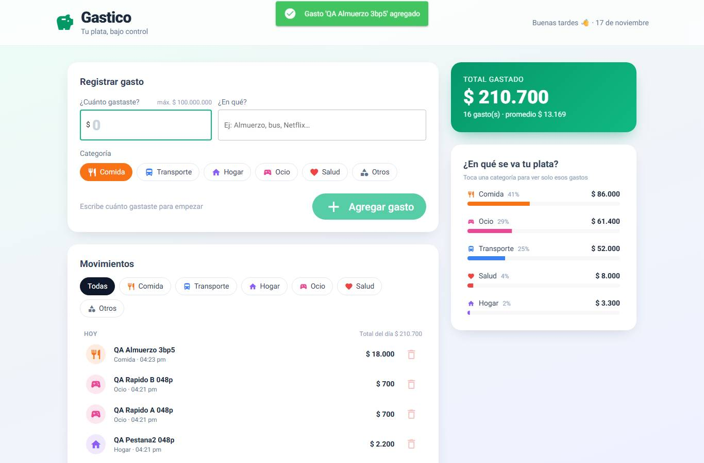
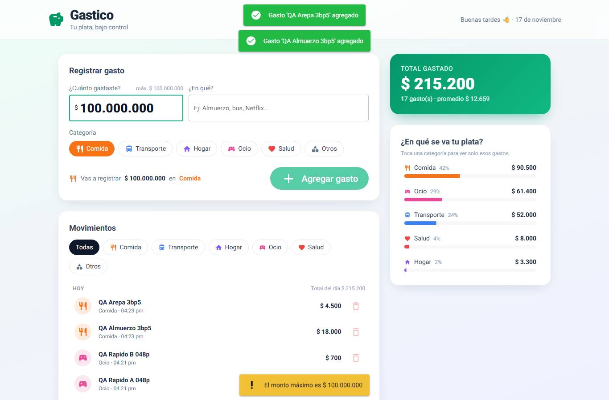
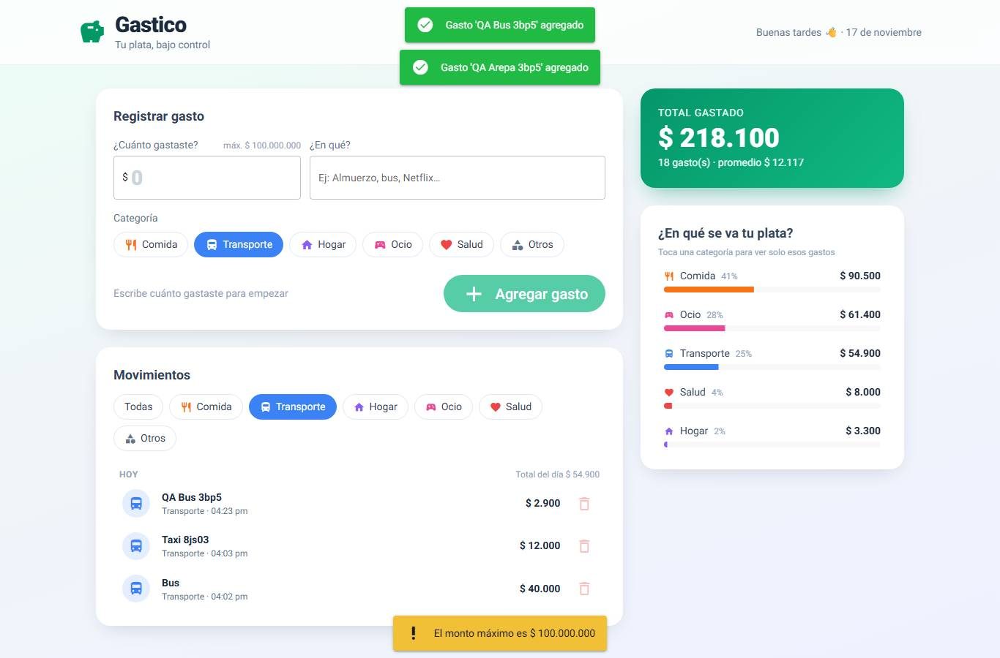
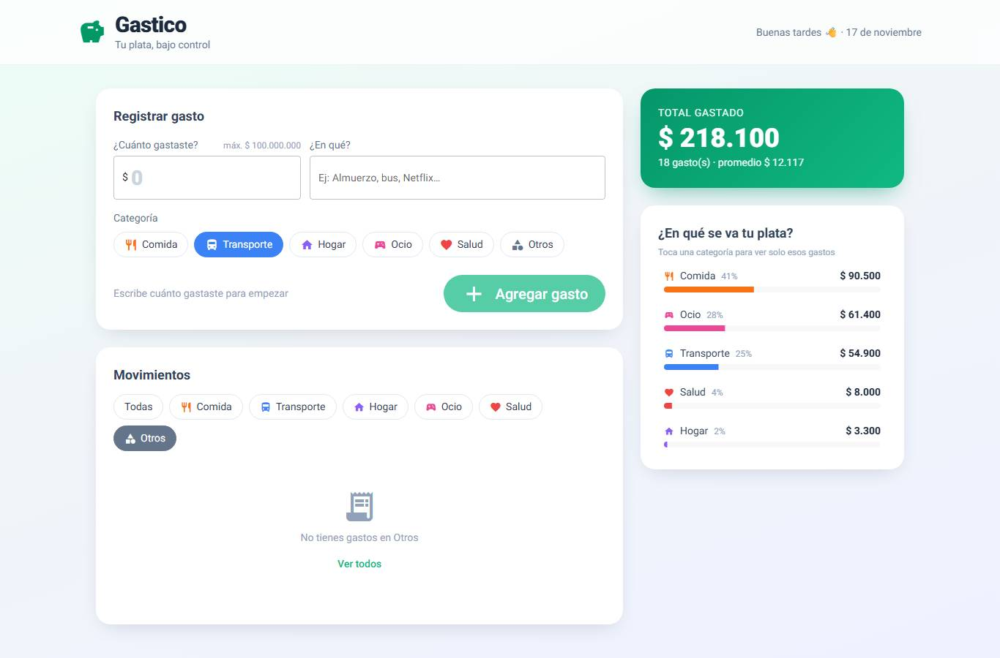
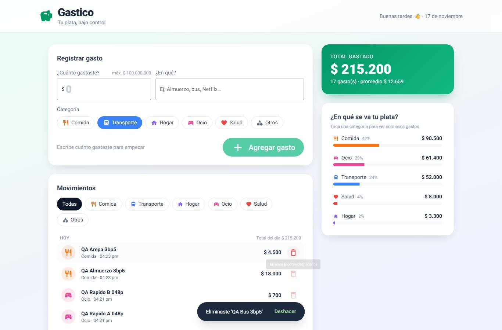
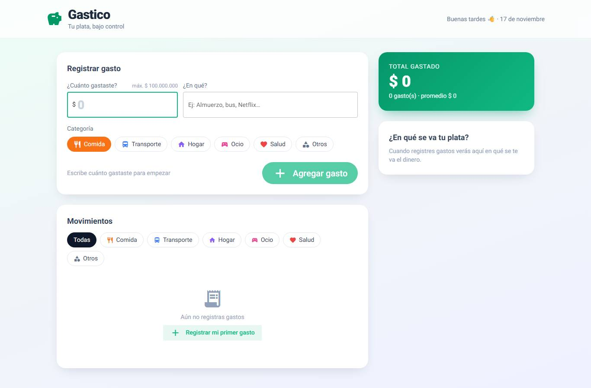
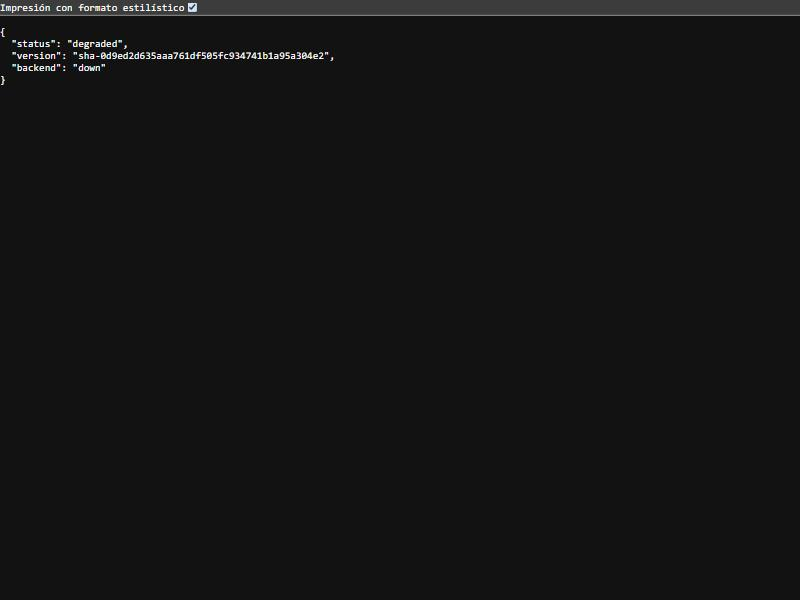

# Evidencias del paso 10: QA en staging

QA de staging con el [checklist](../../qa/checklist-qa.md), secciones A, B, C y D. La aprobación
de producción (secciones E y F) se hace en el paso 12.

## Datos de la corrida

| Campo | Valor |
|---|---|
| Ambiente | staging |
| Versión | `sha-98fdf425a6bc285c3ebc1863dbf5449dc5acdaf1` (merge del PR #10) |
| Runs de GitHub Actions | CI [44119405375](https://github.com/jalopezg4/Proyecto-CICD/actions/runs/44119405375) · CD staging [44120037255](https://github.com/jalopezg4/Proyecto-CICD/actions/runs/44120037255) |
| URL de la app (ALB) | http://gastico-staging-alb-871422411.us-east-1.elb.amazonaws.com |
| Quién hizo la QA | Samuel (Squad Producto y Calidad) |
| Fecha y hora | 17 de noviembre de 2026, 11:23 a 11:27 (hora de Colombia) |
| Navegador | Chromium 158 (Playwright), siguiendo el checklist paso a paso: clics y tecleo uno a uno, con captura por sección y registro de la consola |

Los gastos con nombres como "QA Almuerzo 3bp5" o "QA Fin 3bp5" son de esta QA.

## Resultado

**Secciones A, B, C y D: todo pasa, incluido el escenario 8.3** (backend caído), que se probó
después con el Squad Plataforma sobre `sha-0d9ed2d`. No hay defectos. Hay 4 observaciones de
severidad Baja o sin severidad, al final.

## A. Antes de empezar

- [x] El run del pipeline terminó en verde: CI, release y deploy ([CD 44120037255](https://github.com/jalopezg4/Proyecto-CICD/actions/runs/44120037255): `publicar`, `desplegar` y `probar` en verde)
- [x] La URL de la app abre sin errores de red. El aviso "No es seguro" es el esperado, porque el ALB es solo HTTP
- [x] `/health` responde 200 con estado "ok"
- [x] La versión que informa `/health` es el commit desplegado: `sha-98fdf42…` (8.1)
- [x] Se anotó si el ambiente está recién desplegado: **no lo está**. Ya tiene gastos de las E2E del CD

## B. Funcionalidad

**Registrar**
- [x] Registrar un gasto con monto, descripción y categoría: aparece en la lista (0.1)
- [x] Aparece el aviso verde "Gasto 'QA Almuerzo 3bp5' agregado"
- [x] El formulario queda limpio y el cursor vuelve al monto
- [x] Presionar Enter en la descripción también registra el gasto (3.4)

**Monto y validaciones**
- [x] `-+e1250000` queda `1.250.000` (0.2)
- [x] `150000000` queda en `100.000.000` y avisa "El monto máximo es $ 100.000.000" (3.3)
- [x] "Agregar gasto" está deshabilitado con el formulario vacío, con monto 0 y con una descripción de solo espacios (0.3, 3.1, 3.2)

**Vista previa**
- [x] Sin monto dice "Escribe cuánto gastaste para empezar"; con monto dice "Vas a registrar $ 5.000 en Comida" y cambia a "en Ocio" al elegir Ocio (4.1)

**Resumen y filtro**
- [x] El total y la cantidad suben al registrar: $ 192.700 (15 gastos) → $ 210.700 (16 gastos) (1.1)
- [x] El resumen por categoría muestra la categoría, el monto y el porcentaje (1.2)
- [x] Tocar "Transporte" deja solo gastos de Transporte; tocarlo otra vez, o tocar "Todas", quita el filtro (2.1, 2.2)
- [x] Una categoría sin gastos ("Otros") muestra "No tienes gastos en Otros" y "Ver todos", que vuelve a la lista completa (2.3)

**Eliminar y deshacer**
- [x] Eliminar un gasto lo quita de la lista y del total
- [x] "Deshacer" lo devuelve (0.4)
- [x] Sin tocar nada, la barra de Deshacer desaparece sola y el gasto sigue eliminado (5.1). Se midió 4 veces: la barra aparece en ~130 ms y se va a los 6,6 s
- [x] Primer uso (6.1): "Aún no registras gastos", el botón "Registrar mi primer gasto" lleva el cursor al monto, y el resumen dice "Cuando registres gastos verás aquí en qué se te va el dinero." **Se verificó en `docker compose` con el mismo commit (`98fdf42`)**: en staging el ambiente nunca queda vacío, porque el CD corre las E2E apenas despliega

| | |
|---|---|
|  |  |
|  |  |
|  |  |
|  | |

## C. Comportamiento en AWS

- [x] Recargar la página conserva los gastos (7.1)
- [x] Con la pestaña abierta 2 minutos, registrar otro gasto sigue funcionando (WebSocket vivo a través del ALB)
- [x] Dos pestañas registrando a la vez: las dos funcionan, y al recargar cada una ve los gastos de la otra (sticky sessions)
- [x] Cambiar de categoría, filtrar, registrar y eliminar varias veces seguidas no traba la pantalla
- [x] No hay errores en la consola del navegador (0 errores en toda la corrida, en las dos pestañas)
- [x] Con el backend en 0 tareas, `/health` responde 503 `degraded`/`down` y vuelve a 200 al subirlo a 1 (8.3). Detalle abajo

### 8.3: el backend se cae (17 de noviembre, 20:56 UTC, versión `sha-0d9ed2d`)

Se bajó el servicio `gastico-staging-backend` a 0 tareas con
`aws ecs update-service --desired-count 0` y luego se volvió a 1:

| Momento | `/health` | `/health/live` | Página `/` | Target group del frontend |
|---|---|---|---|---|
| Antes | 200 `ok`, `backend: ok` | 200 | 200 | healthy |
| Backend en 0 tareas | **503 `degraded`, `backend: down`** | 200 | 200 | **healthy** |
| Backend de vuelta en 1 tarea (50 s) | 200 `ok`, `backend: ok` | 200 | 200 | healthy |

Esto confirma el diseño del paso 5:
- el smoke detecta la caída del backend, porque `/health` da 503;
- el frontend **no** se reinicia ni sale del ALB, porque su health check usa `/health/live`, que no depende del backend.

## D. AWS y GitHub

Con la misma versión (`sha-98fdf42`), según [`evidencia-aws.md` del paso 9](../paso-09-staging/evidencia-aws.md):

- [x] ECS: `gastico-staging-backend` y `gastico-staging-frontend` en ACTIVE, 1/1 tareas cada uno
- [x] Target groups del ALB: `gastico-staging-tg` (frontend) y `gastico-staging-backend-tg` en `healthy`
- [x] El backend no responde desde internet. Su security group solo acepta el puerto 8000 desde el ALB interno. Desde internet, `/docs`, `/openapi.json`, `/gastos` y `/gastos/resumen` en el ALB público dan 404 (los atiende el frontend, no el backend). Ver la observación 4 sobre la IP pública
- [x] ECR: no hay críticos sin justificar. En esta versión el escaneo de ECR sale "no disponible" (observación 3). Trivy en el CI la escaneó con 0 HIGH y 0 CRITICAL con arreglo disponible
- [x] SonarCloud: Quality Gate de `main` en **OK** (Passed)
- [x] `/docs` del backend no está expuesto a internet (ver arriba)
- [x] SSM: `/gastico/staging/current` y `/gastico/staging/last-good` existen, con `sha-98fdf42…`

## Tabla de defectos

No se encontraron defectos.

## Observaciones (no son defectos)

| # | Qué se vio | Severidad | Para quién |
|---|---|---|---|
| 1 | Con clics de máquina, sin ninguna pausa, en los chips del filtro (Comida → Todas → Transporte → Todas…), el filtro puede terminar en otra categoría: un clic cae sobre un chip que se está redibujando. Con 300 ms entre clics (ritmo humano rápido) siempre termina bien | Baja | Ninguna acción por ahora |
| 2 | Si el monto se borra y se vuelve a escribir a ~30 ms por tecla, a veces se pierde un dígito (5000 → 500). A 80-100 ms por tecla nunca pasa | Baja | Ninguna acción por ahora |
| 3 | El escaneo de ECR de `sha-98fdf42` sale "no disponible": la imagen se subió como *image index* | — | **Resuelto** en el PR #11. Con `sha-0d9ed2d` las dos imágenes se escanean al subir: 2 HIGH, 11 MEDIUM y 3 LOW, todas sin arreglo disponible (por eso Trivy no las bloquea) |
| 4 | El checklist dice "el backend no tiene IP pública". Desde el PR #8 la tarea sí tiene IP pública, solo para salir a ECR y CloudWatch, pero su security group no acepta nada que no venga del ALB interno. El objetivo (inalcanzable desde internet) se cumple | — | **Resuelto**: el punto del checklist quedó corregido en este PR |
