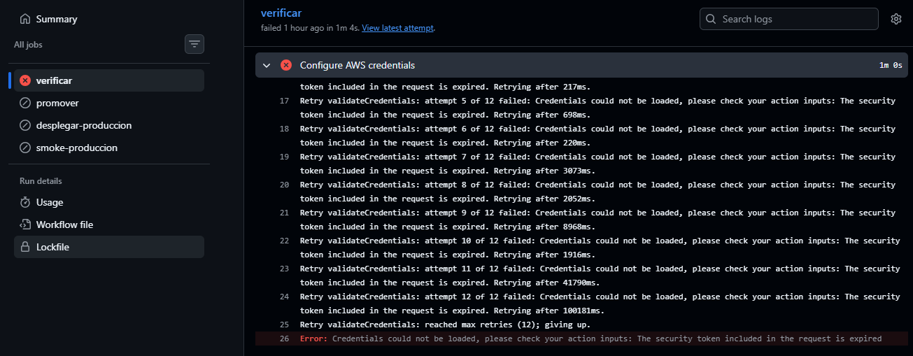
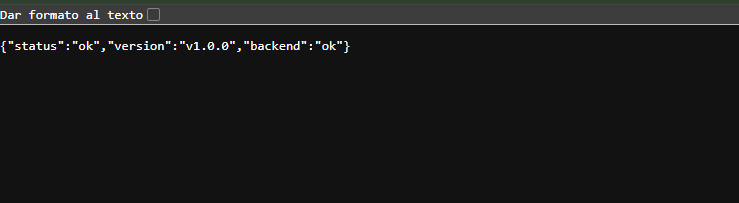
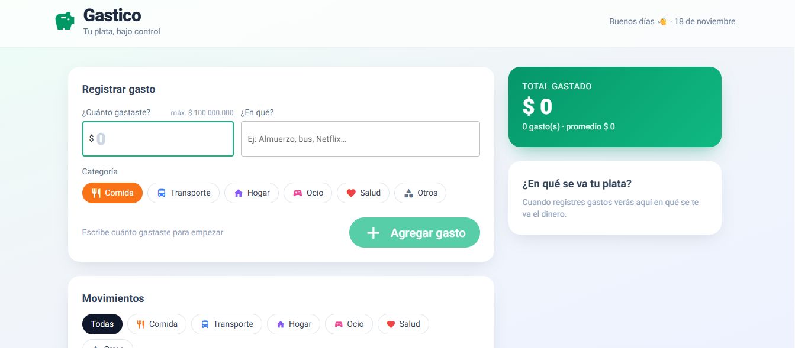
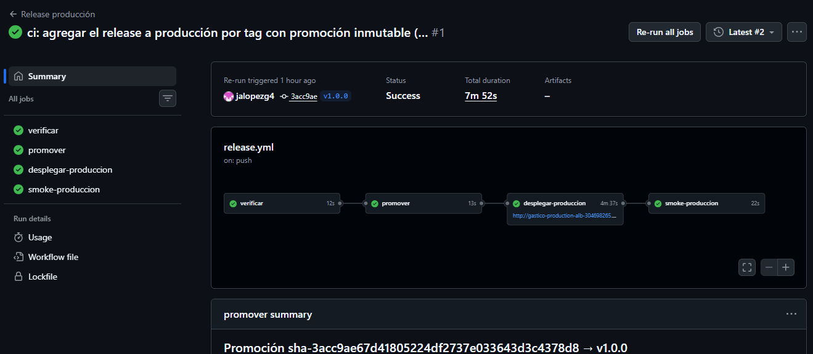

# Evidencias del paso 12: aprobación de producción

Aprobación del release a producción con el [checklist](../../qa/checklist-qa.md), sección E y decisión (F).
La QA de staging (secciones A a D) está en [el paso 10](../paso-10-qa-staging/README.md).

> El despliegue a producción lo aprobó otra persona del equipo antes de esta revisión. Aquí consta la
> comprobación posterior de Producto y Calidad.
> En producción solo se mira: no se registró ni se eliminó ningún gasto.

## Datos de la corrida

| Campo | Valor |
|---|---|
| Ambiente | production |
| Versión (tag) | `v1.0.0` |
| Commit del tag | `3acc9ae` (merge del PR #13, el release por tag) |
| Quién subió el tag | AlDouglas (Squad Plataforma) |
| Run de Release producción | [run #1 de Release producción](https://github.com/jalopezg4/Proyecto-CICD/actions/runs/44220690767) (se ejecutó 2 veces: intento 1 y "Latest #2") |
| URL de la app (ALB) | http://gastico-production-alb-304698265.us-east-1.elb.amazonaws.com |
| Quién aprobó el environment `production` | Jennifer (Squad Plataforma) |
| Fecha y hora de esta revisión | 17 de noviembre de 2026, 22:10 a 22:15 (hora de Colombia) |
| Navegador | Chrome |
| Quién hizo esta revisión | Danna (Squad Producto y Calidad), **después** del despliegue |

## Intento 1 del run

El run se ejecutó dos veces con el mismo tag y el mismo commit (`3acc9ae`):

| Intento | Quién | Resultado |
|---|---|---|
| 1 | AlDouglas (push del tag) | **Falló** en el job `verificar` a 1 min 4 s; `promover`, `desplegar-produccion` y `smoke-produccion` no corrieron |
| 2 | jalopezg4 (*Re-run*) | **Success**, 7 min 52 s, 4 jobs en verde |

Causa del fallo del intento 1: las credenciales de AWS habían vencido. El paso *Configure AWS credentials* del job `verificar` falló con:

```
Error: Credentials could not be loaded, please check your action inputs: The security token included in the request is expired
```

Es la restricción conocida del AWS Learner Lab: los secrets de sesión hay que rotarlos en cada sesión. No es un defecto de la app ni del pipeline. Con los secrets renovados, el intento 2 salió en verde.

Como `verificar` es el primer job y el fallo ocurrió antes de `promover` y del despliegue, el intento 1 no llegó a tocar producción.



## Resultado

**Aprobado.** `/health` responde `ok` con `v1.0.0` y `backend: ok`, la página principal carga y no hay gastos de prueba. Hay una observación de severidad Baja (al final).

## E. Antes de aprobar

- [ ] La misma versión pasó por staging y la QA de staging está completa ([paso 10](../paso-10-qa-staging/README.md))
- [ ] No hay defectos abiertos de severidad Bloqueante o Alta
- [x] El tag es `v1.0.0` y apunta a `3acc9ae`, en `main`; el job `verificar` quedó en verde (comprueba que ese commit es el `last-good` de staging)
- [x] Existe un `last-good` de staging en SSM (lo exige `verificar`). El de producción lo escribe `smoke-produccion` al terminar en verde
- [x] Alguien del Squad Plataforma estaba disponible para el rollback: Jennifer

Comentario con el que se aprobó en GitHub: ""

## E. Después del despliegue

- [x] `/health` responde "ok" con la versión del tag (8.1): `{"status":"ok","version":"v1.0.0","backend":"ok"}`
- [x] La página principal carga con el título "Gastico" y el formulario "Registrar gasto" (8.2)
- [x] Los 4 jobs del run terminaron en verde: `verificar`, `promover`, `desplegar-produccion` y `smoke-produccion` (en este último, el smoke de solo lectura)
- [x] No quedaron gastos de prueba en producción: el resumen dice "$ 0" y "0 gasto(s)", y la vista previa pide "Escribe cuánto gastaste para empezar"







## Promoción de la imagen

Resumen del run (sección Summary, "Promoción sha-... → vX.Y.Z"). Es la misma imagen que probó staging:

| Repositorio | Digest |
|---|---|
| gastico-backend | `sha256:696b05ade211ae9c8f4bee5e72607f8f429e6053a585e54651794f470942c0d8` |
| gastico-frontend | `sha256:2b3b11de05c7205ab5ebcb0c7af88cdeb020211ee1d92fc435797ed9a4e1d20e` |

## F. Decisión

| Resultado | Aprobado |
|---|---|
| Firma de quien hizo la revisión | Danna (Squad Producto y Calidad) |
| Fecha y hora | 17 de noviembre de 2026, 22:15 (hora de Colombia) |

## Tabla de defectos

| # | Qué pasó | Cómo repetirlo | Severidad | Evidencia | Quién lo arregla |
|---|---|---|---|---|---|
| | | | | | |

No se encontraron defectos.

## Observaciones (no son defectos)

| # | Qué se vio | Severidad | Para quién |
|---|---|---|---|
| 1 | La cabecera dice "Buenos días 👋 · 18 de noviembre" cuando en Colombia eran las 22:10 del 17 de noviembre. Lo más probable es que el saludo y el día los calcule el servidor con hora UTC, no con la de Colombia | Baja | Squad Plataforma, por si quieren fijar la zona horaria. No bloquea el release |
